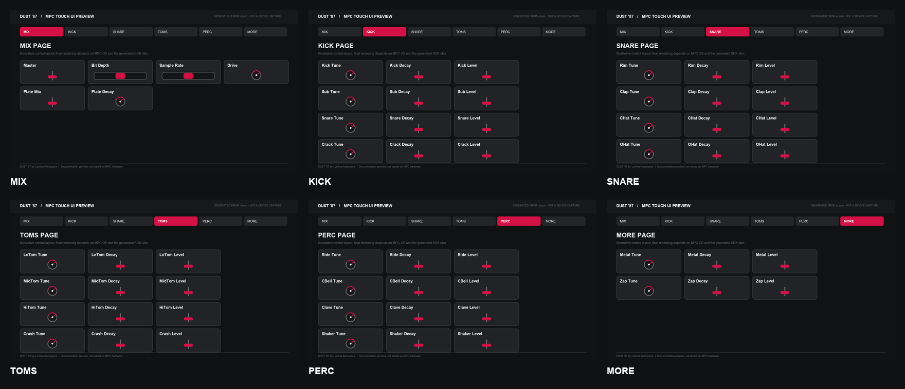
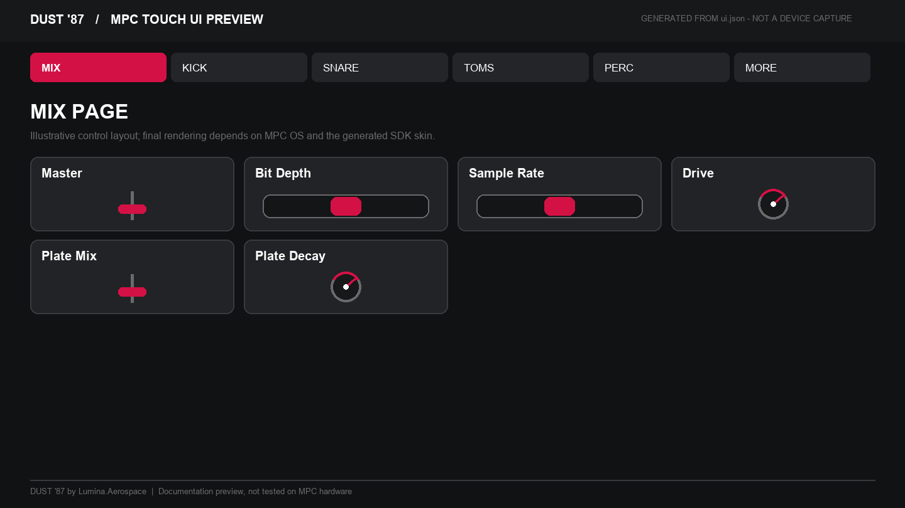

# DUST '87 - MPC Drum Instrument



**A native MPC SDK drum instrument from Lumina.Aerospace.** DUST '87 makes 18 procedural percussion voices, shaped with per-drum Tune, Decay, and Level controls, then processed through lo-fi bit/sample-rate reduction, drive, and plate-style reverb.

> The images above are generated layout previews from `ui.json`, not screenshots captured from MPC hardware. Device screenshots will be added after hardware testing.

## What it is

- **18 procedural percussion voices**, selected by MIDI notes 36-53; out-of-range notes wrap through the same map.
- **Per-voice controls:** Tune, Decay, and Level.
- **Global mix controls:** Master, Bit Depth, Sample Rate, Drive, Plate Mix, and Plate Decay.
- **Eight built-in programs** for factory, tape, sub, lo-fi, dry, and plate starting points.
- **MPC-native sequencing:** use MPC pads and sequences to trigger the instrument; DUST '87 does not include a separate sequencer or emit MIDI.

## Touch UI

The six SDK-generated pages are MIX, KICK, SNARE, TOMS, PERC, and MORE. Each preview is rendered from the current `ui.json`; it is a layout guide, not a capture of the SDK skin running on an MPC.



| Page | Controls |
|------|----------|
| MIX | Master, Bit Depth, Sample Rate, Drive, Plate Mix, Plate Decay |
| KICK | Kick, Sub, Snare, and Crack Tune/Decay/Level |
| SNARE | Rim, Clap, closed-hat, and open-hat Tune/Decay/Level |
| TOMS | Low, mid, and high tom plus Crash Tune/Decay/Level |
| PERC | Ride, Cowbell, Clave, and Shaker Tune/Decay/Level |
| MORE | Metal and Zap Tune/Decay/Level |

## Build and host-test

Check out the [MPC Plugin Builder SDK](https://github.com/inmusic-software/mpc-plugin-builder-sdk). From the SDK checkout, build this repository with:

```sh
python tools/build.py /path/to/mpc-vst-Dust-87 --target all
```

The SDK builds native, ARM32, and ARM64 targets and validates the manifest and generated touch skin. Run its host simulator against the native binary:

```sh
.sdk-tools/host_sim /path/to/mpc-vst-Dust-87/build/native/dust--87.so test --wav /tmp/dust87-test.wav
```

Regenerate the documentation previews after editing `ui.json`:

```sh
python tools/render_ui_previews.py
```

The [Open-MPC release workflow](https://open-mpc.github.io/workflow.html) runs metadata checks, SDK builds, and host simulation. Packaging is manual and defaults to `dry_run: true`.

## Install and release status

The SDK targets MPC OS 3.10.1 or later with **Enable Enhancements** and **External Plugin Support** enabled. Compatibility is not confirmed until the plugin has been installed and exercised on MPC hardware.

Before publishing, test the exact draft-release ZIP on the target device: verify load, playback, save, reload, and uninstall, and run the SDK CPU benchmark on-device. Neither hardware smoke testing nor a device CPU benchmark has been performed. The metadata in `catalog/plugins/dust87.json` is a local proposal, not a listing in the Open-MPC catalog.

## Repository layout

```text
plugin.json                      MPC SDK manifest
ui.json                          six-page MPC touch UI definition
src/DUST87.cpp                   native instrument implementation
docs/screenshots/                generated UI layout previews
tools/render_ui_previews.py      preview image generator
catalog/plugins/dust87.json      proposed Open-MPC registry metadata
.github/workflows/               pinned SDK build and release workflow
scripts/test_release_readiness.py manifest, UI, catalog, and workflow checks
```

The plugin is licensed under GPL-3.0-only; see [LICENSE](LICENSE).
