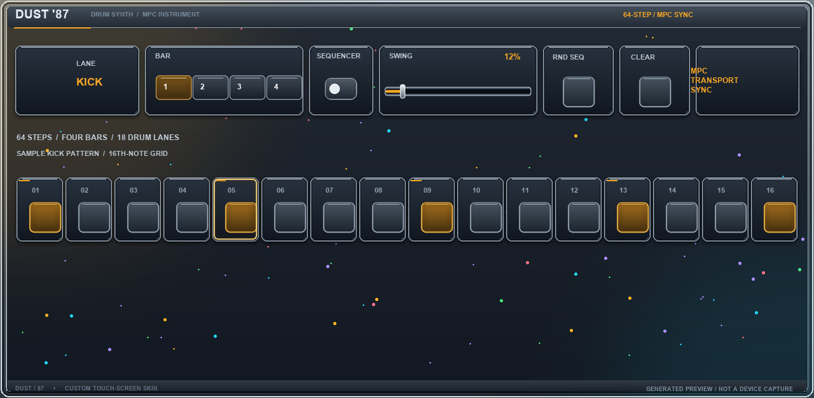

# DUST '87 - MPC Drum Instrument


**A native MPC SDK drum instrument from Lumina.Aerospace.** DUST '87 makes 18 procedural percussion voices, shaped with per-drum Tune, Decay, and Level controls, then processed through lo-fi bit/sample-rate reduction, drive, and plate-style reverb.

> The images above are generated previews composed from the native MPC layout and custom skin assets, not screenshots captured from MPC hardware. Device screenshots will be added after hardware testing.

## What it is

- **18 procedural percussion voices**, with per-voice MIDI channel or note routing and an out-of-range voice fallback.
- **Four banks of 12 pads**, each with editable MIDI channel (1-16), MIDI note (0-127), voice model, Tune, Decay, Level, Mute, Solo, and Choke Group, plus pad audition. Factory MIDI assignments follow the original design: notes 36-83 and channels 1-12 repeated across banks.
- **Per-voice controls:** Tune, Decay, and Level.
- **Global mix controls:** Master, Bit Depth, Sample Rate, Drive, Plate Mix, and Plate Decay.
- **8 built-in factory programs:** Factory 87, Tape Dust, Sub Heavy, Lo-Fi Break, Crate Snare, Dry Machine, Dark Plate, and Bright 12.
- **Built-in 64-step sequencer:** 18 drum lanes, four 16-step bars, adjustable swing, randomize, and per-lane clear. It follows MPC transport and triggers DUST voices internally; it does not emit MIDI.
- **80 built-in grooves** available from a separate native BROWSE page, outside the sequencer.

## DUST '87 step sequencer

The sequencer is optional and **off by default**. Enable it on the SEQ page, choose one of the 18 drum lanes and one of four bars, then tap the 16th-note steps. New steps use velocity 112. Swing ranges from 0 to 40% (default 12%); RND SEQ creates a four-bar groove and arms the sequencer. It follows the MPC host's tempo and PPQ transport, plays while the MPC transport runs, loops every four bars in 4/4, and triggers DUST's own voices. It does not send MIDI to other tracks.



This is a generated UI preview, not a hardware capture. RND SEQ uses the original 20 groove blueprints and variation rules while MPC remains tempo master. The native BROWSE page exposes the 80 built-in grooves as a selectable list. The original browser's genre/search filters and local MIDI-file/folder importer are not part of the native MPC SDK UI, and hardware playback has not yet been tested on an MPC.

## Touch UI

The native skin presents five visible pages: MIX, DRUMS, PAD, SEQ, and BROWSE. DRUMS keeps the original four-bank 4×3 pad-grid interaction together instead of splitting drum families into separate pages. PAD edits the currently selected pad; BROWSE is a separate page and is not embedded in SEQ. The SDK skin has no web-style long-press context sheet, so pad editing is presented on PAD rather than in a browser overlay. A hidden SEQCTL helper page supplies sequencer controls and is merged into SEQ during skin preparation.

The PAD page preserves the original Pad Context Sheet's channel, note, routing, and audition functions. Per-Voice Channel is the default routing mode and uses the first pad assigned to an incoming channel; Combo by Note routes matching notes directly to their pad assignments. The two routing modes intentionally follow the original implementation, including its repeated factory channel assignments across banks.

DUST supplies its own brushed-aluminum faceplate, recessed dark display, beveled control wells, machined-metal knobs and faders, and segmented-button artwork. Every sound knob also has a page-accented ring that follows a hidden, non-automatable MIDI-velocity pulse; the colored dust particles remain part of each page. The previews below are composed from those assets and the `ui.json` control layout, not captured from an MPC.


| Page | Controls |
|------|----------|
| MIX | Master, Bit Depth, Sample Rate, Drive, Plate Mix, Plate Decay |
| DRUMS | Bank selection and 12 pads from the active bank |
| PAD | Selected pad, voice model, Tune, Decay, Level, Mute, Solo, Choke Group, MIDI Channel, MIDI Note, MIDI Routing, Audition Pad, Randomize, Reset |
| SEQ | 64-step editor, voice lane, bar selection, swing, randomize, and clear |
| BROWSE | Selection and load action for 80 built-in grooves |

## Build and host-test

Check out the [MPC Plugin Builder SDK](https://github.com/inmusic-software/mpc-plugin-builder-sdk). From the SDK checkout, the first build generates the native parameter dump; then generate and patch the TUI before building all device targets:

```sh
python tools/build.py /path/to/mpc-vst-Dust-87 --target native
python tools/gen_ui.py --params /path/to/mpc-vst-Dust-87/build/params.json --out /path/to/mpc-vst-Dust-87/build/generated-skin --kit-cache /path/to/mpc-vst-Dust-87/build --ui /path/to/mpc-vst-Dust-87/ui.json
python /path/to/mpc-vst-Dust-87/tools/prepare_mpc_skin.py --generated /path/to/mpc-vst-Dust-87/build/generated-skin --params /path/to/mpc-vst-Dust-87/build/params.json --output /path/to/mpc-vst-Dust-87/skins
python tools/build.py /path/to/mpc-vst-Dust-87 --target all
```

The SDK builds native, ARM32, and ARM64 targets and validates the manifest and custom touch skin. After the first setup, rebuilds only need the `--target all` command. Run the SDK host simulator against the native binary:

```sh
.sdk-tools/host_sim /path/to/mpc-vst-Dust-87/build/native/dust--87.so test --wav /tmp/dust87-test.wav
```

Regenerate the custom skin art and documentation previews after changing its design:

```sh
python tools/render_skin.py
python tools/render_ui_previews.py
```

If the native parameter layout changes, regenerate the SDK TUI and run `prepare_mpc_skin.py` again before packaging. The artwork generator requires Pillow; the SDK build itself uses the committed PNG assets and does not require Pillow. The generated graphics and animated knob overlays are native MPC skin assets, not a browser UI.

The [Open-MPC release workflow](https://open-mpc.github.io/workflow.html) runs metadata checks, SDK builds, and host simulation. Packaging is manual and defaults to `dry_run: true`.

## Install and release status

The SDK targets MPC OS 3.10.1 or later with **Enable Enhancements** and **External Plugin Support** enabled. Compatibility is not confirmed until the plugin has been installed and exercised on MPC hardware.

Before publishing, test the exact draft-release ZIP on the target device: verify load, playback, save, reload, and uninstall, and run the SDK CPU benchmark on-device. Neither hardware smoke testing nor a device CPU benchmark has been performed. The metadata in `catalog/plugins/dust87.json` is a local proposal, not a listing in the Open-MPC catalog.

## Repository layout

```text
plugin.json                      MPC SDK manifest
ui.json                          MPC touch UI page and control layout
src/DUST87.cpp                   native instrument, pad grid, and sequencer implementation
src/sequencer_clock.h            PPQ/swing clock for the 64-step loop
src/groove_library.h             80 built-in grooves and randomizer blueprints
docs/screenshots/                generated UI layout previews
assets/                           custom backgrounds and native control artwork
tools/render_skin.py              custom MPC skin asset generator
tools/render_ui_previews.py      preview image generator
tools/prepare_mpc_skin.py        native sequencer and beat-ring skin preparer
catalog/plugins/dust87.json      proposed Open-MPC registry metadata
.github/workflows/               pinned SDK build and release workflow
scripts/test_release_readiness.py manifest, UI, catalog, and workflow checks
```

The plugin is licensed under GPL-3.0-only; see [LICENSE](LICENSE).
